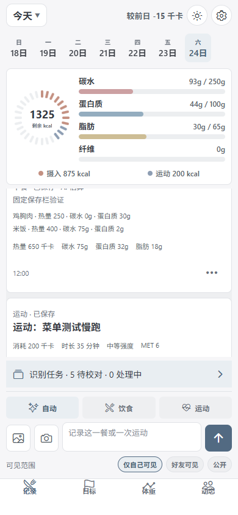
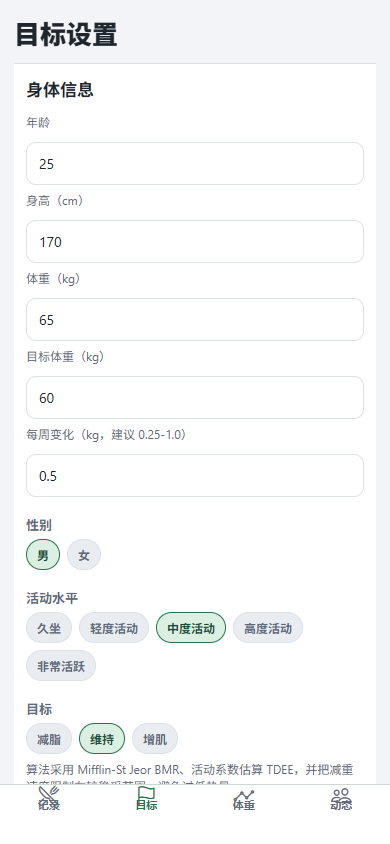
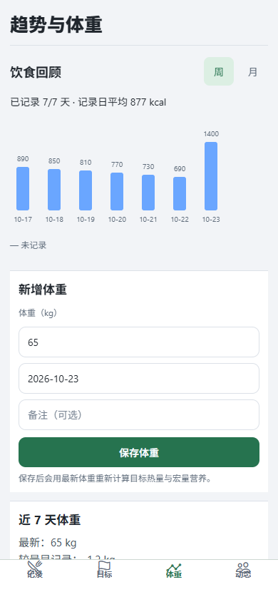

# NutriFlow · 营养日记

React Native / Expo + Express + SQLite 的饮食、运动、体重和社交记录应用。当前版本重点是：图片/文字 AI 识别、饮食和运动自动分类、每日目标营养、体重追踪、好友动态、记录可见范围、云端后端独立使用。

## 应用截图

真实运行界面（Expo Web 移动尺寸，演示数据），依次为记录与营养、目标设置、趋势与体重。

<p>
  
  
  
</p>

## 当前版本与下载

- Android 版本：**1.6.2**（`versionCode: 12`）。
- 移动端构建标识：`2026-10-25-r26`。
- [v1.6.2 发布说明](https://github.com/Qian-Que/nutriflow/releases/tag/v1.6.2)
- [下载 Android APK](https://github.com/Qian-Que/nutriflow/releases/download/v1.6.2/NutriFlow-v1.6.2-android.apk)
- 安装要求：Android 7.0（API 24）及以上。优先覆盖安装；不要为更新版本直接卸载，以免丢失尚未同步的本地草稿。
- 此次发布不改变主备 AI 配置；测速功能不会发布草稿，也不代表第三方模型已通过真实图片测试。

APK SHA-256：

```text
d79b0399e955e57fc5d96a684cf2d19b4aa75c999e8e11727915407ec2be4d6a
```

近期更新包含日间/夜间主题、营养图表、离线草稿与同步恢复、管理员全局 AI 配置，以及 Gemini 输出额度、分段响应解析和错误提示改进。

### 1.6.2 识别后直接保存

- 新上传默认在服务器识别后直接保存，自动更新记录和营养统计，不再每次进入人工校对。上传确认后即可离开应用，重新打开自动恢复结果。
- 低置信度、图片转文字估算只保留提示，不强制确认；仍可在记录中编辑。识别失败不创建记录，保存失败保留识别结果和图片，可重试保存而不重复调用模型。
- 旧的待校对结果不自动覆盖，任务列表支持“直接保存”或“编辑”；直接保存优先使用已有本机校对修改。最近 20 条已保存任务保留分段耗时。
- 保持原始日期、餐次、可见范围、图片及模型来源，重复上传/重试不会重复入账，删除过的记录不会被重新创建。
- 验证包含后台自动保存、低置信度、文字降级、失败恢复、权限与幂等回归，浏览器实时入账与旧修改保留，以及安卓模拟器上传后关闭应用再打开。未连接 iQOO 真机。

### 1.6.1 设置返回后的底部布局修复

- 修复设置中弹出键盘、返回记录页时底部“可见范围”容易被导航栏遮挡的问题。记录页改用按实际键盘遮挡留空的布局，不再固定为缓存的初始高度。
- 设置弹窗使用独立安全区域；打开或关闭设置时收起键盘，设置中的键盘不再驱动背后记录页与底栏收缩。
- 输入区和可见范围作为不可压缩的整体，列表让出空间；窄屏可换行，底部导航只计算一次安全区域。
- 保留当前配色、可见范围选项和原有草稿。增加单选控件的选中状态语义及模拟器回归脚本 `mobile/scripts/verify-settings-return.ps1`。
- 用户报告机型为 iQOO Neo9 Pro。验证覆盖模拟器的多次返回、设置键盘、记录输入键盘、主题切换和 1.3 倍字体，以及 Web 移动尺寸；不等同于该机型真机验证。

### 1.6.0 品牌视觉与记录操作

- 图标、Android 自适应图标、原生启动页与登录标志统一为简洁 N 形标志，低饱和雾蓝配柔和珊瑚色细节。启动页使用与 SDK 54 匹配的 `expo-splash-screen`，本地初始化结束后直接进入应用，不添加人为等待。
- 去除绿色与高饱和亮蓝，日间使用浅灰层次，夜间使用中性深灰；雾蓝用于操作，柔和珊瑚色强调热量，营养类型保留低饱和多色区分。减轻字重、描边与数据标签的色块，日期栏去掉重复边框。同步覆盖记录、目标、体重、动态、设置、校对和编辑，安卓光标也使用雾蓝。
- 记录卡片只保留一个三点操作入口，替代重复的“编辑 / 更多”和分散按钮。饮食菜单包含编辑、再记一次、常用餐食、删除；运动只显示适用操作。
- 删除与再记一次需确认，菜单忙碌时锁定、防止连点；失败在菜单内显示并允许重试，待同步记录不能编辑或删除。删除成功响应丢失后再次请求，已不存在的记录按删除完成处理。
- 饮食与运动编辑表单采用固定标题、可滚动内容和底部保存/取消栏；键盘弹出时仍可操作，窄屏不必滚到表单末尾才能保存。
- 包名、签名、存储键、后台识别及 AI 配置不变。新增 `verify-record-actions.cjs` 和 `verify-brand-assets.cjs`，覆盖操作确认、防连点、失败重试、待同步限制和图标尺寸/透明度/像素校验。

图形源文件为 `mobile/assets/brand-mark.svg`；`cd mobile` 后运行 `npm run brand:assets` 可重新生成图标资源。原生启动配置更新使用 `npx expo prebuild --platform android --no-install`（不使用 `--clean`），保留已有签名，再按原流程构建。启动页验证使用 release APK，参见 [Expo 官方说明](https://docs.expo.dev/versions/latest/sdk/splash-screen/)。

### 1.5.1 名称统一与更新兼容

- 产品名称统一为 **NutriFlow**，中文副标题为 **营养日记**，GitHub 仓库改为 `Qian-Que/nutriflow`。
- Android 桌面名称、登录页、Web 标题与发布资料统一；保留包名 `com.qianque1.nutritionassistantcn`、签名、Expo 项目标识和本地存储键，支持覆盖安装。
- 新版更新检查使用 `/api/releases/latest?format=2` 返回新仓库地址；无参数接口保留旧版认可的链接，由 GitHub 重定向到新仓库，避免 1.4.0/1.5.0 无法升级。新客户端也兼容并规范化已有的更新缓存。
- 请勿重新创建名为 `nutrition-app` 的仓库，否则 GitHub 的旧地址重定向会失效，参见 [GitHub 仓库改名说明](https://docs.github.com/en/repositories/creating-and-managing-repositories/renaming-a-repository)。
- Railway 公网地址和 AI 配置保持不变。本地目录 `E:\AI\healthydiet` 保持原路径，避免影响工作区和构建配置；目录名不是产品展示名称。
- 打包安装脚本遇到签名不匹配时停止，不再自动卸载旧应用，以保护用户数据。

### 1.5.0 上传后后台识别

- 收到“已上传”确认后即可切换页面、锁屏或关闭应用，服务器继续识别；不必保持手机亮屏等待模型。上传未确认时先保留本机原文、照片和固定请求 ID，再次打开自动查询或重试同一任务。上传确认前仍需保持网络连接。
- 记录页新增“识别任务”，按全部、处理中、待校对、失败筛选。可以连续上传，不必先处理上一条结果；失败可重试，排队或完成的任务可放弃。完成后在应用中恢复，不包含系统推送通知。
- 待校对结果、原图和记录日期在服务器保存，跨重启恢复；逐条校对草稿按任务在本机保存，确认前不计入营养统计。保存某条结果不会清空正在输入的下一餐，旧版未保存的校对草稿仍可继续处理。
- 分段显示上传确认、排队、判类、识别和文字降级耗时。上传确认是客户端请求到服务器确认的往返时间，不是纯文件传输；识别包含上游网络、模型生成、解析及主备回退。未测得的上传时间不会伪造为零；重试显示本次尝试耗时。
- 每账号最多 5 条在途、50 条未处理任务，同一账号串行调用模型；单实例全局最多 4 个运行、16 个在途。空闲时不持续轮询，有未完成任务时仅在前台刷新。Gemini 主备线路、模型和密钥保持原配置。
- 任务与照片仅所属账号可访问。确认入账与任务状态更新在同一事务内完成，响应丢失后重试不重复入账；保存或放弃后清理任务原图。未处理结果和原图保留到确认或放弃，不再套用旧任务 24 小时清理规则。
- 服务重启后自动恢复排队任务，运行中任务最多自动重跑一次，超过后提示手动重试。上游请求可能重复执行或计费，固定记录 ID 仅保证不重复入账，不保证第三方模型只调用一次。

新增验证：`server/scripts/verify-background.cjs`、`server/scripts/verify-job-migration.cjs`、`mobile/scripts/verify-background-client.cjs`。后端构建、移动端类型检查及既有回归通过；浏览器验证连续上传、上传/保存响应丢失、页面关闭后恢复、图片保存、逐条校对与下一餐保留，以及 320/390/1280 宽度。Android APK 已通过签名、覆盖安装、键盘、强制关闭后任务恢复和旧校对草稿兼容检查。使用隔离账号和模拟 AI，未连接真实手机，也未对当前 Gemini 线路做实际测速或准确率评测。

升级后端时会在增加任务列之前通过 SQLite `VACUUM INTO` 自动生成一致性备份，文件名为 `<数据库路径>.pre-background-v15-<时间戳>.bak`，位于原数据库所在持久卷；备份失败会阻止本次迁移。当前调度仍面向单实例 SQLite。**不要直接把后端回退到 1.4.0**：旧版任务写入不兼容新增列。回退须先停止写入并备份现有数据库，再准备兼容迁移或经核对的备份恢复方案，避免丢失升级后的记录。

### 1.4.0 结果校对与移动端体验

- 记录页识别完成后先进入校对，确认前不入账。饮食可改名称、克数和各项营养值，支持整餐减半/加倍、补充遗漏食物、移除误识别食物；运动可改名称、时长、消耗和 MET。
- 模型自报把握低于 0.7、缺失把握值，或图片失败后按文字估算时，须明确勾选“已核对”。模型把握值不等于真实准确率，所有结果仍是估算。
- 校对草稿按账号和服务器隔离保存。关闭校对、系统返回或重启应用后，可点“继续校对识别结果”恢复；保存使用固定请求 ID，断网重试不重复入账。放弃结果会保留原描述，下一次重新识别。
- 单项克数修改同步缩放其营养值并重算整餐；因没有逐项微量营养来源，单项营养或份量修改后会去掉原整餐微量估算，避免沿用失效值。整餐倍数缩放则同步缩放微量营养。
- 键盘弹出时收起记录页图表和底栏，留出输入与列表空间；校对采用全屏可滚动表单、固定保存栏，运动编辑框增加滚动。系统返回优先退出详情/日历，校对返回保留草稿。
- 选择照片不再强制裁剪或重复预压缩；显示处理状态并防止重复打开，取消/失败保留原内容，相机权限不足可前往设置。仍使用最长边 1280 的 JPEG 与 320 像素缩略图。
- 设置新增当前版本、检查更新和正式发布页入口；新版提示可按版本关闭。应用启动延后检查，成功结果在本机缓存 6 小时，失败不会显示“已是最新”，也不阻塞记账。仅接受本仓库正式 Release 且 APK 上传完成的版本，不接受预发布、草稿或其他下载域名，不自动安装。
- 后端新增公开只读 `GET /api/releases/latest`，统一获取 GitHub 发布元数据，成功缓存 5 分钟、失败退避 30 秒；不向 GitHub 传用户身份或密钥。下载仍需能访问 GitHub。1.3.0 及以前的 APK 没有提醒功能，需要先手动安装 1.4.0。
- Android 网络安全配置仅对 `localhost`、`127.0.0.1` 和模拟器宿主 `10.0.2.2` 放行 HTTP；其他地址使用 HTTPS。本地 USB 调试可使用 `adb reverse tcp:4109 tcp:4109`。配置插件在重新生成原生工程后仍会保留该规则，参见 [Android 官方配置说明](https://developer.android.com/privacy-and-security/security-config)。

新增回归：`mobile/scripts/verify-review-update.cjs`、`server/scripts/verify-updates.cjs`。浏览器已验证低把握确认、份量校正、关闭/重开恢复、丢失保存响应后的幂等、图片校对保存、运动校对、更新失败提示、按版本关闭提醒，以及 320/390/1280 宽度。测试使用隔离账号和模拟 AI，不改变线上模型配置。

Android 1.4.0 APK 已通过签名校验、模拟器覆盖安装、登录、输入与校对键盘避让、系统返回和强制结束进程后的草稿恢复。未连接真实手机，因此未声称完成真实相机方向、厂商键盘或真实 AI 服务端到端测试。

### 1.3.0 可靠性与性能

- 识别改为持久任务：网络中断后保留草稿与任务 ID，再次发送相同内容会查询原任务，避免重复调用模型。新接口为 `POST /api/recognition/jobs` 和 `GET /api/recognition/jobs/:id`，任务仅所属账号可读。
- 自动分类、主备回退、文字降级共用默认 150 秒上游预算；可用 `RECOGNITION_TIMEOUT_MS` 设置 1000–180000 毫秒。队列等待不计入模型预算；客户端等待结束后仍可按原任务重取结果。
- 已结束任务在创建满 24 小时后，由后续新任务触发清理；完成后立即清空服务端输入字段。服务重启时，未完成任务标为失败，不自动重复收费请求。任务调度针对当前单实例 SQLite 部署。
- 图片降级为文字估算会明确标注，不再伪装成成功识图。新照片压缩至最长边 1280，生成 320 像素缩略图；照片独立存入 `food_images`，列表只取引用，详情按需取原图且检查权限。
- 日志查询支持 `limit`、`offset` 和 `compact=1`；新版客户端自动取完当日分页，旧版接口仍可返回内联图片。旧照片按需迁移，数据导出仍包含完整照片。
- 合并并发读取；空闲时不轮询记录，只在页面可见且有待同步项时重试同步。修复“较前日”净摄入计算。
- 禁止本地接口故障或重开应用时静默换到云端。生产环境必须显式设置非默认 JWT 密钥；AI 错误统一脱敏。
- 应用层限制：每 IP 每 15 分钟登录/找回各 30 次、注册 10 次；每用户 AI 每分钟 12 次、每日默认 200 次（UTC，可通过 `AI_DAILY_LIMIT` 调整）。持久任务每用户最多一个在途，最多 4 个运行、16 个在途；旧同步接口另有并发限制。被限流返回 429 和 Retry-After。

部署前应备份 SQLite 数据库。图片迁移不会删除原始图片字节，但若要降级服务器到 1.3.0 之前，须先备份、停止写入，在 1.3.0 代码下运行 `node scripts/restore-inline-images.cjs` 恢复旧版的内联表示，然后再切换旧代码；该脚本不删除独立图片表。

新增验证：`server/scripts/verify-reliability.cjs`、`mobile/scripts/verify-recognition-client.cjs`。已验证任务幂等/超时/权限、图片访问/迁移/导出、分页、限流、草稿重试；浏览器通过断网恢复、图片显示、32 秒空闲零列表请求和本地地址重开保留测试。APK 已通过模拟器安装与启动冒烟检查，不代表完成真实手机相机及真实 AI 服务全链路验证。

### 1.2.0 体验与速度改进

- 日夜主题采用中性背景、清晰边界和多色营养图表；统一照片、相机、发送图标，增大常用操作触控区域。
- 新增自动、饮食、运动三种记录类型。明确选择饮食或运动后，跳过前置 AI 分类请求；自动模式保留原有分类流程。
- 显示保存草稿、分类、识别、保存记录等实际阶段与已用时间。请求期间锁定输入并防止重复提交。
- 有缓存时先显示记录；静默刷新不再弹出大加载指示器。保存完成后，列表和日历后台刷新，不阻塞下一次输入。
- 设置页可独立测试主、备用线路，保留最近四次成功的文字测试耗时；增加“兼容·Chat”协议选项，避免仅支持 Chat 的服务先尝试 Responses。

### 如何判断 API 是否慢

在“设置 → 全局 AI”中分别测试主备线路。后端识别耗时包含后端到服务商的请求、模型生成与解析；总等待还包含客户端到后端的往返和应用处理，二者差值不是精确网络延迟。测试只使用固定文字，不代表图片识别速度或质量。

国内视觉备用可先评估阿里云百炼 `qwen3-vl-flash`，官方文档列明支持视觉理解且默认不开启思考。协议选择“兼容·Chat”，接口地址和模型可用性以账号控制台为准，使用独立密钥。[千问视觉文档](https://help.aliyun.com/zh/model-studio/vision/)、[兼容 API 文档](https://help.aliyun.com/zh/model-studio/qwen-api-via-openai-chat-completions)。

第二候选是火山方舟 `doubao-seed-2-0-lite-260428`；该版本默认开启思考，官方支持关闭，但当前应用尚未提供该服务商专用的思考参数开关，因此不能保证直接接入后更快。[模型列表](https://docs.volcengine.com/docs/ark/model-list?lang=en)、[思考模式](https://docs.volcengine.com/docs/ark/deep-thinking?lang=zh)。

本次未使用这些供应商的真实密钥做速度或食物识别质量对比，也未替换线上模型。建议用同一组餐食照片比较完整结果耗时、识别正确率和失败率，再决定主备顺序；Railway 到国内服务的跨境链路也可能影响速度。

## 新窗口快速衔接

如果重新打开 Codex 或新窗口，先看这一节即可。

### 当前项目位置

- 主仓库：`E:\AI\healthydiet`
- 移动端源码：`E:\AI\healthydiet\mobile`
- 后端源码：`E:\AI\healthydiet\server`
- 当前 Android 打包目录：`E:\AI\healthydiet\mobile`；`E:\mobile_clean\mobile` 是历史镜像，不作为当前发布来源。
- GitHub：`https://github.com/Qian-Que/nutriflow.git`

### 当前线上后端

- Railway 主服务：`strong-amazement`
- Railway 公网地址：`https://strong-amazement-production-c91d.up.railway.app`
- Railway Root Directory：`server`
- 另一个 `nutrition-app` Railway 服务是旧/失败服务，排查时优先忽略。

### 当前移动端默认配置

- 默认后端地址写在 `mobile/App.tsx`：`CLOUD_DEFAULT_API_BASE_URL`
- 当前构建标识写在 `mobile/App.tsx`：`APP_BUILD_LABEL`
- 本地 `.env` 只影响本地启动/打包时的移动端变量；云端 AI 优先使用管理员在应用设置中保存的全局配置，没有已保存配置时才使用 Railway Variables。

### 最近已完成的主要功能

- 饮食记录改为卡片式输入：文字、图片、图片附加描述都走 AI 识别。
- 运动记录支持文字和运动截图识别，后端会先分类是饮食还是运动，再走对应分析。
- 记录卡片支持编辑、删除、详情页。
- 详情页显示健康分析、营养/运动明细、使用的 AI 模型。
- 目标页支持目标体重、减重/增重效率，按 Mifflin-St Jeor BMR + 活动系数估算。
- 新增体重追踪页，支持体重记录和趋势图。
- 动态/好友系统支持饮食和运动同时展示。
- 记录可见范围会记忆上一次选择。
- 后端默认长期保留数据；只有显式设置正整数 `DATA_RETENTION_DAYS` 才会清理超期数据。
- 支持日间/夜间主题、营养图表、离线草稿、同步恢复、数据导出和管理员全局 AI 设置。
- Gemini 响应解析支持分段内容，区分输出截断、内容拦截、空答案和协议不匹配。
- 国内网络稳定性只做了安全优化：GET/HEAD 请求失败或 5xx 时重试一次；POST/PUT/DELETE 不自动重试，避免重复新增/删除。

### 最近一次已验证

在最近一次后端改动后已验证：

```powershell
cd E:\AI\healthydiet\server
npm run build

cd E:\AI\healthydiet\mobile
npx tsc --noEmit
```

1.1.2 功能提交：`ad6d72d Handle Gemini output limits and streamed response diagnostics`。该版本已通过后端构建、移动端类型检查、AI 测试/响应解析、权限与数据保留、离线同步回归检查；APK 构建和签名校验通过。第三方主线路实际可用性仍需在应用设置中测试。

1.2.0 已通过上述回归检查，并验证主备测试权限隔离、密钥隔离、明确类型跳过分类、自动模式保留分类、输入锁定，以及 320/390/1280 宽度无页面横向溢出。浏览器流程使用隔离测试账号与模拟 AI 响应；未声称完成安卓真机端到端测试。

## 目录结构

```text
E:\AI\healthydiet
├─ server   # Express + SQLite 后端
├─ mobile   # Expo React Native App
└─ docs     # Railway / Render 部署文档
```

注意：`docs` 里的部分中文文档可能有编码乱码，以本 README 为当前准确信息。

## 后端本地开发

```powershell
cd E:\AI\healthydiet\server
npm install
Copy-Item .env.example .env
npm run dev
```

默认本地地址：

```text
http://127.0.0.1:4000
```

测试：

```powershell
curl http://127.0.0.1:4000/health
```

浏览器打开根路径 `/` 显示 `接口不存在：GET /` 是正常的，要测 `/health`。

## 移动端本地开发

```powershell
cd E:\AI\healthydiet\mobile
npm install
Copy-Item .env.example .env
npm run start
```

手机独立使用时，登录页接口地址应填写 Railway HTTPS 地址，不要填 `127.0.0.1` 或局域网 IP。

```text
https://strong-amazement-production-c91d.up.railway.app
```

## Railway 部署

Railway 设置：

- Source Repo：`Qian-Que/nutriflow`
- Branch：`main`
- Root Directory：`server`
- Start Command：`npm run start`
- Public Networking Port：`4000`
- Healthcheck Path：`/health`

建议挂载 Volume：

- Mount Path：`/data`
- SQLite 路径变量：`SQLITE_PATH=/data/nutrition.db`

必填变量：

```env
PORT=4000
NODE_VERSION=22
JWT_SECRET=换成足够长的随机字符串
CORS_ORIGIN=*
SQLITE_PATH=/data/nutrition.db
```

AI 主线路变量：

```env
AI_PROVIDER=openai_compat_auto
AI_BASE_URL=https://你的服务商地址/v1
AI_API_KEY=你的key
AI_MODEL=支持文字和图片的模型
AI_IMAGE_DETAIL=auto
AI_TIMEOUT_MS=90000
```

AI 备用线路变量：

```env
AI_BACKUP_PROVIDER=openai_compat_auto
AI_BACKUP_BASE_URL=https://备用服务商地址/v1
AI_BACKUP_API_KEY=备用key
AI_BACKUP_MODEL=备用模型
AI_BACKUP_IMAGE_DETAIL=auto
AI_BACKUP_TIMEOUT_MS=90000
```

Gemini 原生或 Gemini 代理注意：

- Gemini 原生适配支持 `.../v1beta` 和 `.../v1beta/models` 两种地址，不要附加密钥或 `:generateContent`。
- 如果是 OpenAI 兼容代理，才使用 `/v1` 这种地址。
- 管理员可在应用的“设置 → 全局 AI”中修改模型、接口和密钥，保存后对所有用户的新识别请求生效，无需改源码或重新打包。“测试主线路”不会保存草稿，也不会回退到备用线路。
- Railway Variables 是没有已保存全局配置时的默认值；已有全局配置时，仅修改环境变量不会覆盖它。可在应用中恢复服务器环境配置。本地 `server/.env` 只影响本地后端。
- 移动端 `mobile/.env` 只影响 App 访问哪个后端，不控制云端 AI 模型。

## Android 打包

当前已在英文路径 `E:\AI\healthydiet\mobile` 直接完成 release 构建，无需同步到旧镜像。

### 1. 准备当前源码

```powershell
cd E:\AI\healthydiet\mobile
npm ci
```

### 2. 快速打包

```powershell
cd E:\AI\healthydiet\mobile
powershell -NoProfile -ExecutionPolicy Bypass -File .\scripts\build-install-android.ps1 -Variant release -SkipInstall
```

如果需要构建后安装到已连接的手机：

```powershell
cd E:\AI\healthydiet\mobile
powershell -NoProfile -ExecutionPolicy Bypass -File .\scripts\build-install-android.ps1 -Variant release
```

APK 常见输出路径：

```text
E:\AI\healthydiet\mobile\android\app\build\outputs\apk\release\app-release.apk
E:\AI\healthydiet\mobile\android\app\build\outputs\apk\debug\app-debug.apk
```

### 3. 安装到手机

```powershell
$env:Path += ";$env:LOCALAPPDATA\Android\Sdk\platform-tools"
adb devices
adb install -r E:\AI\healthydiet\mobile\android\app\build\outputs\apk\release\app-release.apk
```

如果安装后仍是旧版，先检查 APK 的版本号和安装结果，关闭并重新打开应用。不要直接卸载；卸载会删除本地未同步数据。可检查手机已安装版本：

```powershell
adb shell dumpsys package com.qianque1.nutritionassistantcn | Select-String "versionCode|versionName"
```

## 常见打包问题

### `SDK location not found`

创建或修正：

```powershell
Set-Content -Path E:\AI\healthydiet\mobile\android\local.properties -Value "sdk.dir=C:\\Users\\13162\\AppData\\Local\\Android\\Sdk"
```

### `adb` 找不到

```powershell
$env:Path += ";$env:LOCALAPPDATA\Android\Sdk\platform-tools"
adb devices
```

### `EBUSY ... classes.dex`

说明 Android Studio、Gradle、Java 或资源管理器占用了构建文件。先关闭 Android Studio、模拟器、相关终端和资源管理器预览，再执行：

```powershell
taskkill /F /IM java.exe /T
taskkill /F /IM gradle.exe /T
taskkill /F /IM node.exe /T
cd E:\AI\healthydiet\mobile
npm run build:android:local
```

注意：杀 `node.exe` 会停止正在运行的 Metro 或本地后端。

### `Unable to load script`

这是 debug APK 没有打包 JS bundle 或没有连接 Metro。要独立安装使用，打 release APK，或者用脚本的 release 构建。

## 当前 API 功能概览

认证：

- `POST /api/auth/register`
- `POST /api/auth/login`
- `GET /api/auth/me`
- 不安全的旧密码重置接口已禁用，不应依赖旧流程重置账号密码。

饮食：

- `POST /api/nutrition/analyze-text`
- `POST /api/nutrition/analyze-image`
- `GET /api/logs`
- `POST /api/logs`
- `PUT /api/logs/:id`
- `DELETE /api/logs/:id`
- `GET /api/logs/calendar`

运动：

- `POST /api/exercises/analyze`
- `GET /api/exercises`
- `POST /api/exercises`
- `PUT /api/exercises/:id`
- `DELETE /api/exercises/:id`

体重：

- `GET /api/weights`
- `POST /api/weights`
- `DELETE /api/weights/:id`

目标：

- `GET /api/profile/targets`
- `POST /api/profile/targets`

动态/好友：

- `GET /api/feed/friends`：好友动态，包含饮食和运动。
- `GET /api/friends/:friendId/profile`：好友详情和统计。
- `GET /api/friends/:friendId/logs`：好友某天可见饮食和运动记录。
- `GET /api/friends/:friendId/calendar`：好友可见日历统计，包含运动消耗。

## 数据保留策略

后端默认长期保留数据。只有显式将 `DATA_RETENTION_DAYS` 设置为正整数时，才按该天数清理以下超期数据；未设置或为 `0` 时不自动清理：

- 饮食记录 `food_logs`
- 运动记录 `exercise_logs`
- 体重记录 `weight_logs`
- 指向旧饮食记录的群组动态 `group_posts`

启用保留期限后的清理触发时机：

- 后端启动时执行一次。
- 后端运行中每天执行一次。

启用清理前应先备份数据库或导出记录；清理会永久删除超期数据。默认保留策略下，旧数据继续显示属于正常行为。

## AI 识别策略

当前后端流程：

1. 先让 AI 判断输入是 `food` 还是 `exercise`。
2. 饮食走营养估算，要求中文结果和结构化 JSON。
3. 运动走运动类型、时长、强度、MET、消耗热量估算。
4. 主线路失败后尝试备用线路。
5. 详情页底部会显示本次实际使用的模型。

注意事项：

- 运动截图需要图片模型能看懂截图文字；如果模型不支持视觉，截图只能失败或误判。
- 运动和食物混合输入时，模型可能误判。现在后端已加强分类提示，但仍建议一句话描述清楚，例如“这是 Keep 运动截图，请按运动记录识别”。
- 营养微量元素是 AI 估算，不等同于真实检测值。详情页会尽量根据现有字段补齐，不应大量显示 `-`。

## 网络稳定性说明

国内访问 Railway、GitHub、Gemini、部分模型代理都可能不稳定。当前项目只做了安全范围内的优化：

- GET/HEAD 请求出现网络错误或 5xx 时自动重试一次。
- POST/PUT/DELETE 不自动重试，避免重复写入或重复删除。

如果仍不稳定，真正有效的方案是：

- 后端迁到国内云服务器。
- 或给 Railway 后端加国内可访问的反向代理/CDN。
- 或继续使用 Cloudflare Worker/自有域名中转 AI 模型请求。

不要盲目给所有请求加重试，否则最容易造成重复记录。

## 开发检查命令

后端：

```powershell
cd E:\AI\healthydiet\server
npm run build
```

移动端：

```powershell
cd E:\AI\healthydiet\mobile
npx tsc --noEmit
```

Git：

```powershell
cd E:\AI\healthydiet
git status --short
git log -5 --oneline
```

推送：

```powershell
git push origin main
```

如果 GitHub 连接失败，多半是网络问题，稍后重试或开启可访问 GitHub 的网络环境。

## 排查优先级

遇到问题按这个顺序排查：

1. 手机 App 登录页接口地址是否为 `https://strong-amazement-production-c91d.up.railway.app`。
2. 浏览器是否能打开 `https://strong-amazement-production-c91d.up.railway.app/health`。
3. Railway 当前部署是否成功，确认服务是 `strong-amazement`。
4. 管理员全局 AI 设置是否正确，尤其接口地址、模型、密钥和协议；没有已保存配置时再核对 Railway Variables。
5. 手机是否安装了最新 APK，而不是旧版缓存。
6. 如果只改后端，等待 Railway 自动部署即可；如果改了 `mobile/App.tsx`，必须重新打包安装 App。

## 健康算法边界

- BMR 使用 Mifflin-St Jeor 公式。
- TDEE 使用活动系数估算。
- 目标体重速度会折算为每日热量调整，并设置保守限制。
- 运动消耗基于 MET、体重、运动时长估算。
- 所有营养和运动结果用于日常记录，不等同于医生或注册营养师建议。
